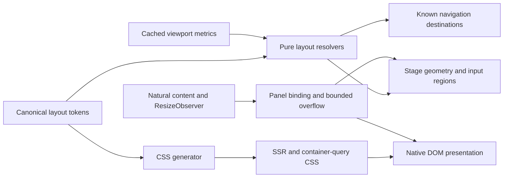

# Shared layout and DOM presentation

The responsive layout separates known page geometry from natural content measurement. `packages/core/src/spatial-element/layoutTokens.json` supplies pure TypeScript resolvers and `scripts/generate-layout-css.mjs`. The generated stylesheet is available during SSR; no browser measurement is required to choose grid columns, media fits or fixed pane regions.

## Width and viewport ownership

Viewport layout uses seven width classes. Content grids use four classes based on their own unpadded query container. The ordinary content cap is 1536px. A 3XL detail pane is a distinct container and can therefore select M while its outer viewport selects 3XL. Padding and gutters belong to the Section, not to an additional host wrapper.

`ResponsiveViewportMetrics` owns a stable-height probe, safe-area values and reserved scrollbar width. Stage exposes cached metrics through `getLayoutMetrics('stable' | 'visible')`; SSR has no metrics object. Consumers must not independently mix `screen.height`, `innerHeight`, physical pixels and DOM widths. Changed cached measurements invalidate panel layout, so resize order cannot leave dock geometry using an older viewport.

## Natural height remains natural

A summary constraint defines width, anchor and overflow policy. It does not invent a height for unknown text. The persistent summary host owns independent Svelte roots; route placement nodes request and release presentation. Native summaries remain in document flow where required. DOM reparenting alone is insufficient to preserve a component whose owner is being destroyed.

The single detail-tab navigation moves to the dock or 3XL submenu host. Focus and horizontal scroll are preserved. `Element.moveBefore` is used only for an eligible same-document move with compatible connected state; route teardown can require ordinary insertion into the detached original owner.

## One document scroll coordinate

The virtual document translates by `-visualScrollY`. Fixed 3XL regions compensate by exactly `+visualScrollY`. Their bindings are marked as viewport-owned and must not subtract document scroll again. The ordinary navigation shell applies the corresponding bounded 112px offset once.

The pane body remains in ordinary flow with reserved header/submenu space. Clip painting follows cached document origin, body height and scroll position; it does not change document extent. Anchor and focus handling read the same visible reading window. Crossing the split/flow boundary preserves a cached reading-section anchor after reflow rather than retaining an obsolete numeric scroll position.

Native fallback uses CSS layout and covers outside the reading area. It does not pretend those opaque covers are GPU glass over live DOM. Integrated pane/summary content uses native surfaces; eligible controls over the scene can retain their authored GPU material.

## Validation boundaries

Pure tests cover token boundaries and arithmetic. Browser fixtures compare SSR, native hydration and real WebGPU geometry, exercise anchors/focus/history and retain live inputs across zoom/resize. Private brand fixtures cover integration and palettes; public documentation depends only on neutral demo assets.

See the [illustrated layout guide](../wiki/Home.md), [content specification](../design/layout/content-layout.md), [detail specification](../design/layout/detail-layout.md) and [3XL production evidence](../design/layout/ultrawide-scroll.md). Navigation timing and staged destination binding have separate acceptance gates; a valid rectangle is not proof of a smooth or immediate GPU transition.
