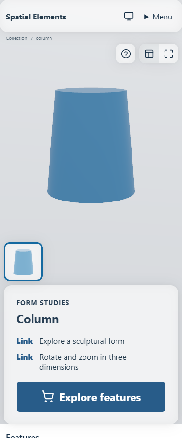
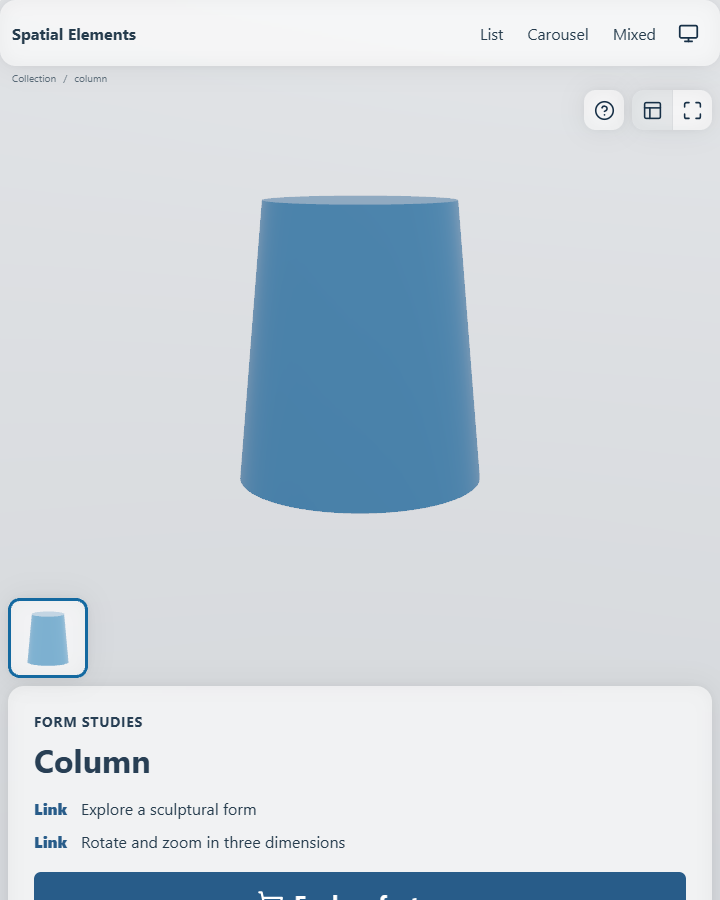
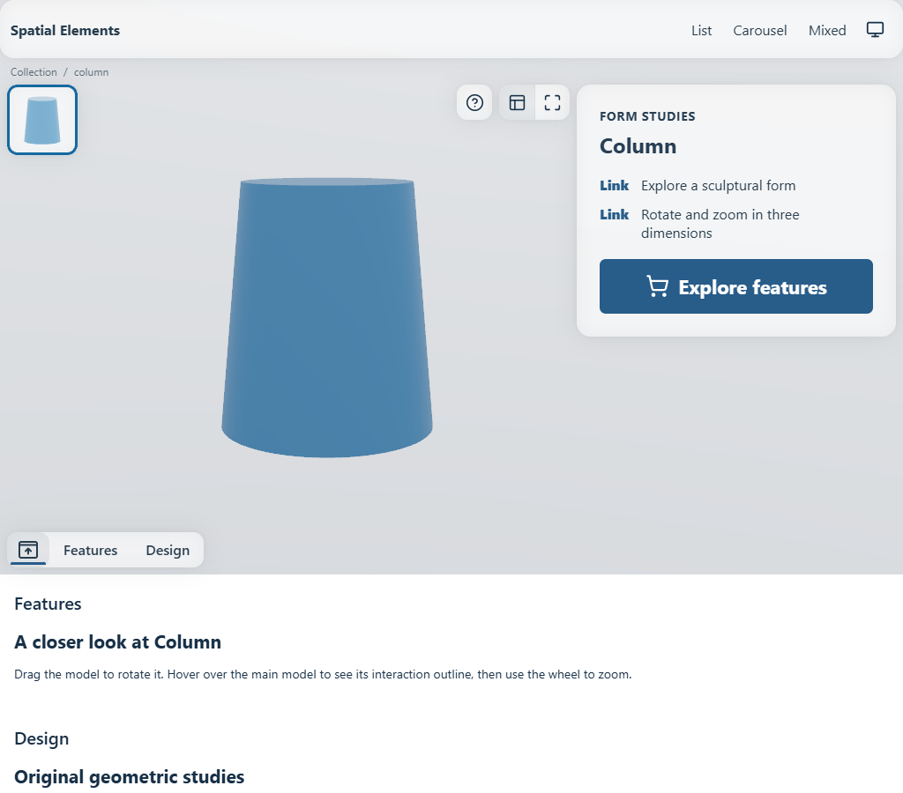
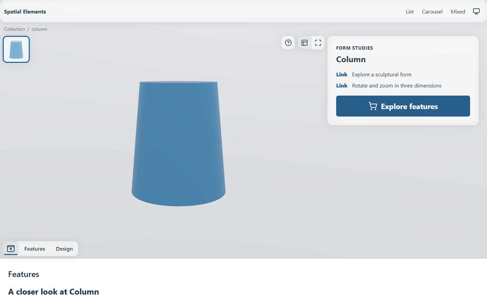
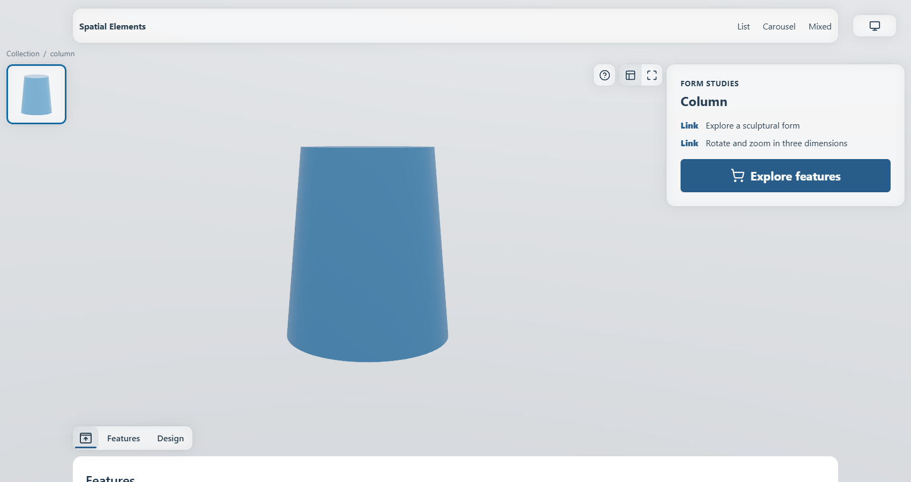
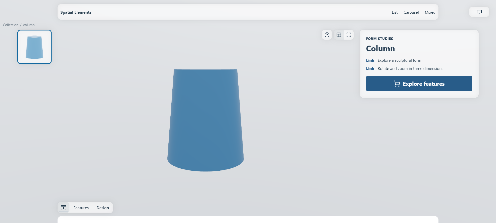
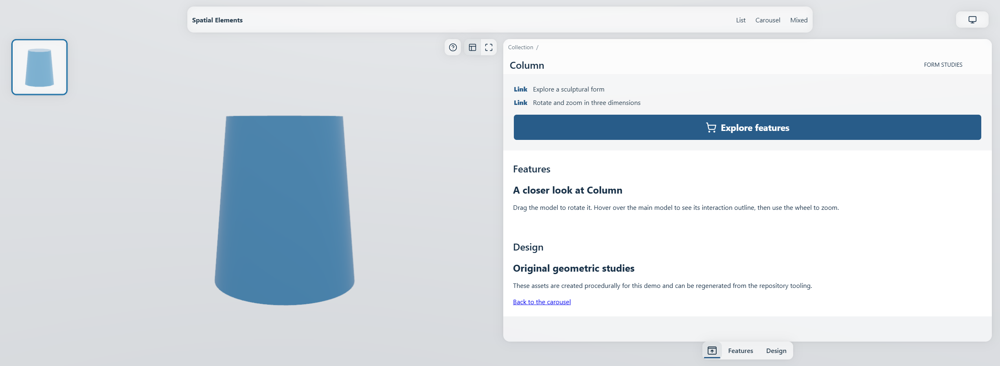

# Detail Layouts

`SpatialElementPage` combines one media fit, a media rail, a natural-height summary and ordinary sections. The same layout resolver supplies CSS and the renderer. A model is fitted using its full 3D bounds, including depth; projecting a near corner must not push it outside the allocated fit rectangle.

The detail fit rectangle is a containment boundary. `camera.fitPadding` reserves space inside it, and `camera.fitScale` can reduce that padding when enlarging an element. Enlargement stops at the rectangle's edges; older magnification values cannot move the resting geometry under the media rail or summary. A smaller `fitScale` still leaves more space around the model. Interactive zoom deliberately leaves this resting fit while the surrounding interface clears away.

## Flow layouts: XS through 2XL

XS and S place the media rail horizontally below the model, followed by the summary. M and wider place a vertical rail at the left and the summary beside the model. Content follows the hero; the section submenu appears from M. Natural panel height is bounded by the hero where appropriate, with local summary overflow rather than arbitrary global height assumptions.

| Layout | Media-fit height rule | Rail item | Summary |
| --- | --- | --- | --- |
| XS | clamp(viewport height − 214, 150, 400) | 80 | Full available width minus 8px per side, below media |
| S | clamp(viewport height − 214, 150, 500) | 80 | Full available width minus 8px per side, below media |
| M | clamp(viewport height − 180, 300, 500) | 80 | Three grid columns |
| L | clamp(viewport height − 194, 340, 600) | 80 | Four grid columns |
| XL | clamp(viewport height − 236, 400, 700) | 112 | Four grid columns |
| 2XL | clamp(viewport height − 216, 400, 800) | Up to 138, constrained to the available left space | Four grid columns |
| 3XL | Usable height − 112 | 138 | Inside the right pane |

Safe areas and the usable viewport are applied before resolving these rectangles. The 2XL rail also respects its 7% viewport-width limit and minimum outside inset. The media itself preserves aspect ratio; these heights describe the allocation, not a stretched model or image.

Vertical swipes over the rail and properties panel can continue scrolling the document. The horizontal rail confines its horizontal scroll direction; a summary with overflowing content scrolls locally until its edge, then passes the gesture to the page. Breadcrumbs use the centered content width in flow layouts and the pane width in 3XL. Detail and fullscreen controls use the dedicated box icons from the layout design.

## Seven sizes in the public demo

These are individual WebGPU screenshots of `/demo/elements/column`, all at 900 CSS pixels high. They show the same content and resting camera, with no private brand assets. The viewport capture intentionally stops at the browser edge; content below it remains reachable by ordinary document scrolling.

### XS: 375px wide

*The compact menu remains usable, and the summary fills the available reading width.*

### S: 720px wide

*The summary continues below the viewport; its height is not compressed to fit one screen.*

### M: 1024px wide

*The composition changes at M. Content still follows the hero in document flow.*

### L: 1440px wide

*The summary uses four grid columns, with the controls immediately beside its upper edge.*

### XL: 1700px wide

*The menu gains its top inset and satellite slots. Detached content sections use the capped centered container.*

### 2XL: 2000px wide

*The detail composition is still in flow; widening the viewport does not stretch ordinary content beyond its cap.*

### 3XL: 2456px wide

*The pane owns its header and bottom section navigation. Its live content scrolls with the document.*

## Docking while reading

Scrolling a flow detail page brings a compact header into view and moves the existing minimap into it. The header is 76px at XS/S, 80px at M and 86px from L. The section submenu is absent at XS/S, 40px at M and 44px from L.

The docked model's projected upper edge aligns with the viewport's safe top edge. Its fit square may extend above the header, but its geometry does not get clipped there. Hover enlargement and device rotation recompute this alignment from the live 3D pose; the model grows downward. If enlargement reaches beyond the safe left edge, only the necessary horizontal correction is applied, without reducing the model or its hover motion. The correction blends into the normal scroll morph, and the prepared navigation endpoint uses the same geometry.

There is exactly one live section-navigation element. Its ownership moves from the source panel into the dock; it is not duplicated into separately focusable desktop/mobile versions. Link identity, horizontal scroll and keyboard focus survive the move. Returning restores it to the source position. When route teardown has already detached that source, the controller uses an ordinary DOM move rather than an invalid state-preserving atomic move.

## Zoom and fullscreen

Zoom expands the media interaction area and removes page chrome from interaction. The detail button returns to the fitted pose. Fullscreen uses the browser API when available and a viewport presentation otherwise; Escape returns without discarding the page's scroll position.

The minimap is bottom-left at XS/S and top-left from M. Tools remain upper-right. Insets and minimap sizes are layout-owned, so they must not be hard-coded by host CSS. Reduced motion changes animation behavior without removing accessible controls.

The [ultra-wide composition](Ultra-Wide-Layout.md) uses a fixed media region and a document-scrolling pane instead of the flow dock. [Media and Interaction](Media-and-Interaction.md) describes image/video behavior in the same fit.

## Why heights are bounded, not universally fixed

A shared width and known media rectangle make navigation predictable. Text can still be longer, translated or authored with a custom snippet. Preserving natural summary height avoids clipping content merely to force all pages into an identical bitmap. Test both short and long summaries at every composition boundary.
