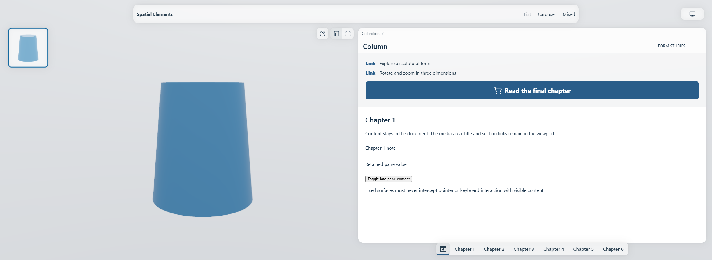

# Spatial Elements layout guide

Build ordinary, accessible content first. The shared layout then supplies the same rectangles to CSS, the 3D renderer and navigation. Pages remain usable without JavaScript or WebGPU.



*Public `/demo/layout-pane` fixture, 2456 × 900 CSS pixels. The model, controls and pane header stay in place while the document scrolls.*

Start with [Layout and Content Grid](Layout-and-Content-Grid.md), then [Sections and Backgrounds](Sections-and-Backgrounds.md) and [Lists and Cards](Lists-and-Cards.md). For product pages, read [Detail Layouts](Detail-Layouts.md), [Summary Panels](Summary-Panels.md) and [Media and Interaction](Media-and-Interaction.md). [Ultra-Wide Layout](Ultra-Wide-Layout.md) explains the split composition. [Navigation and Glass](Navigation-and-Glass.md) covers the persistent shell. [Migration and Reference](Migration-and-Reference.md) collects compatibility rules and test fixtures.

## A small content page

Inside an existing `BrandStageShell`, ordinary content needs no geometry or renderer setup:

```svelte
<script lang="ts">
  import { ContentPage, ContentGrid, ContentBlock, Section } from '@spatial-elements/sveltekit';
</script>

<ContentPage hdr="/assets/demo/studio.hdr" page={{ title: 'Collection' }}>
  <Section section={{ id: 'intro', title: 'Introduction', headline: 'Designed to explore',
    background: { color: 'standard' } }}>
    <ContentGrid>
      <ContentBlock span={{ xs: 4, m: 4, l: 8 }}>
        <p>Main content stays in reading order.</p>
      </ContentBlock>
      <ContentBlock span={{ xs: 4, m: 4, l: 4 }}>
        <p>Related content uses its own explicit span.</p>
      </ContentBlock>
    </ContentGrid>
  </Section>
</ContentPage>
```

The executable public fixtures are the reference for complete shell setup and loading data. A **viewport layout** selects the page composition; a **content grid** depends on the width of its own container. A **fit rectangle** allocates space for undistorted media. A **summary** is live HTML with natural height, not a fixed bitmap or a second cloned component.

## Why the layout is shared

DOM measurements still matter for natural text height and custom content. They do not define the known page geometry. Pure layout functions resolve known rectangles from CSS width, stable viewport height, scrollbar width and safe areas. Generated CSS uses the same tokens. This makes native fallback, enhanced rendering and navigation agree without rebuilding an entire target page merely to discover its basic shape.

These guides document the implemented layout. The staged-navigation integration is documented separately when its acceptance gates are complete; a predictable destination rectangle alone is not a promise of sub-100ms navigation on every device.
