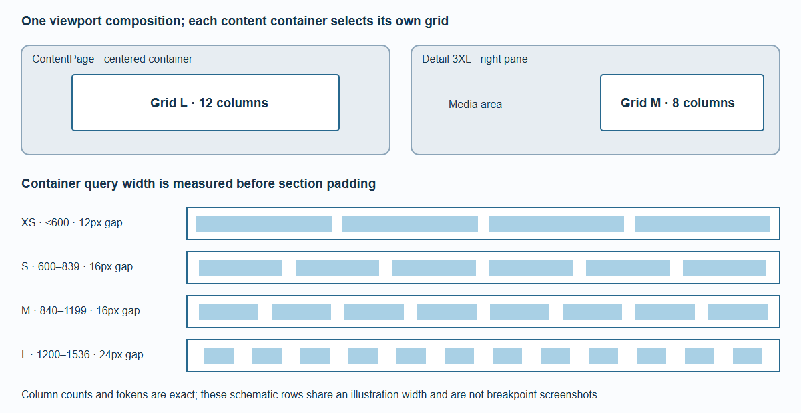

# Layout and Content Grid

Viewport layout controls the overall page. Container width controls its content grid. Keeping these separate lets a wide screen contain a narrower detail pane without forcing desktop-sized columns into it.



*The grid measures its unpadded container. Section padding is the grid's single outer gutter; it is not added a second time.*

## Viewport composition

All dimensions are CSS pixels. Device pixel ratio does not choose a breakpoint.

| Viewport width | Layout | Ordinary content width |
| --- | --- | --- |
| Below 600 | XS | Available width |
| 600–839 | S | Available width |
| 840–1199 | M | Available width |
| 1200–1599 | L | Available width, capped at 1536 |
| 1600–1808 | XL | Available width minus two 136px insets, capped at 1536 |
| 1809–2299 | 2XL | 1536 maximum |
| 2300 and wider | 3XL | Ordinary ContentPages remain capped at 1536; detail uses a separate pane |

Scrollbar and safe-area insets reduce usable space. A 3XL viewport shorter than 512 usable pixels uses the 2XL detail flow composition. The [ultra-wide guide](Ultra-Wide-Layout.md) gives pane geometry.

## Four container grids

<!-- layout-grid-table:start -->
| Container width | Grid | Columns | Padding / gap | Headline size / line height | Body size / line height | Headline gap |
| --- | --- | --- | --- | --- | --- | --- |
| < 600 | XS | 4 | 12 | 18 / 28 | 14 / 20 | 8 |
| 600–839 | S | 6 | 16 | 18 / 28 | 14 / 20 | 8 |
| 840–1199 | M | 8 | 16 | 20 / 32 | 14 / 20 | 12 |
| 1200–1536 | L | 12 | 24 | 24 / 40 | 16 / 24 | 16 |
<!-- layout-grid-table:end -->

Headlines use weight 600; body text uses 400. Font family belongs to the host theme. The grid uses the width **before** section padding: an 840px container selects M, even though the padded content is 808px wide.

For container width `c`, column count `n` and gutter `g`, one column is `(c - 2g - (n - 1)g) / n`. A span of `s` columns is `s * columnWidth + (s - 1)g`. Fractional pixels are retained. This matters when GPU text must align with native text on the first enhanced frame.

## Explicit blocks

`ContentGrid` adds no second section padding. Put `ContentBlock` components inside it. `span` accepts a number or an object keyed by `xs`, `s`, `m`, `l`:

```svelte
<ContentGrid>
  <ContentBlock span={{ xs: 4, s: 3, m: 4, l: 8 }}>Main</ContentBlock>
  <ContentBlock span={{ xs: 4, s: 3, m: 4, l: 4 }}>Related</ContentBlock>
</ContentGrid>
```

Omitted spans fill a row. Responsive spans inherit the last smaller defined value; before the first defined value they fill a row. Invalid values fall back to a row and oversized spans clamp to the active column count, with development diagnostics. Blocks keep DOM and keyboard order. There is no dense backfilling that visually reorders content.

Arbitrary Section children remain ordinary HTML. Opt into blocks deliberately; the framework does not distribute paragraphs into columns automatically.

## Inspect it

Open `/demo/layout-grid` and resize the container independently of the window. Boundary tests cover fractional widths around 600, 840 and 1200, classic scrollbars, embedded containers and the 1536px cap. The tokens are the source of truth; generated CSS and the reference tables must be regenerated together when they change.
