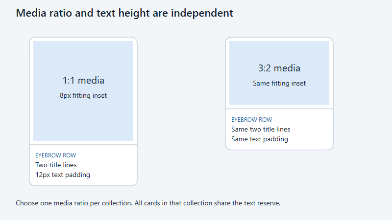
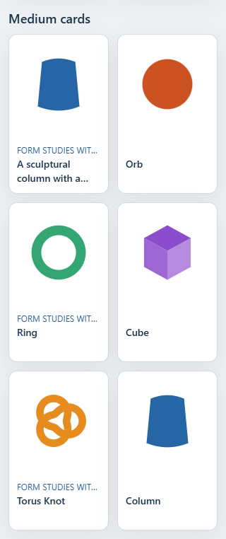
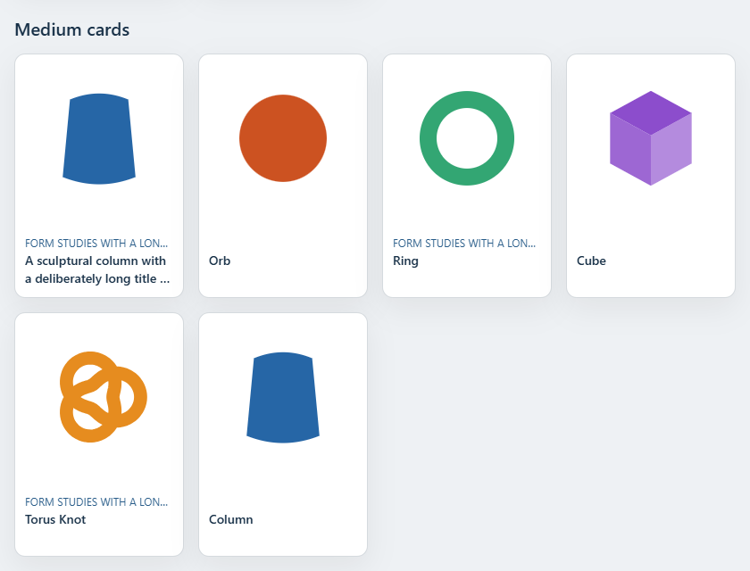
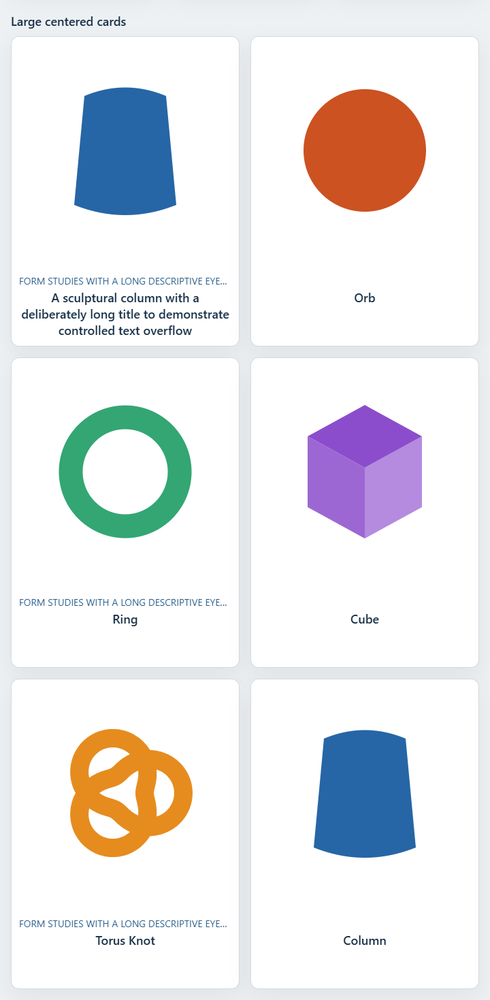

# Lists and Cards

Cards use Page Sections 0.3.0. The media frame has its own configurable aspect ratio; the text area adds independent height. All cards in a collection have equal heights across rows.

- S: 2 columns, 12px title, two title lines, no eyebrow.
- M: 2 columns, 14px title, two title lines.
- L: 4 columns (3 in grid S), 18px title, three title lines.
- M/L reserve an additional eyebrow row for every item when any item has a nonblank eyebrow.
- Text padding is 12px; contained media has an 8px inset.

Use `mediaAspect="1/1"` (spatial default), `"3/2"` or `"4/3"`, `mediaFit="contain"` (default) or `"cover"`, and `cardTone="standard"` or `"muted"` on ListSection. SpatialListPage forwards these options. Keep `itemKey` stable for repeated items and reordering.

```svelte
<ListSection section={{ id: 'collection', title: 'Collection', headline: 'Collection' }}
  list={items} cardSize="l" mediaAspect="1/1" mediaFit="contain" cardTone="muted" />
```

## Measured media and independent text



The media frame alone has an aspect ratio. At 320px, an M card is 142px wide, with a 126px square inset fitting area. With an eyebrow row the full card is 226px high. Blank eyebrows reserve the same line as populated items. Long titles clamp while the native link retains the full accessible title.

Spatial adapters measure the actual media element for geometry, camera fitting and transition targets. Format changes never stretch a model. Persistent card roots and occurrence identities survive navigation and keyed moves.

## Interaction and fallback

Cards remain real links with posters and readable labels before hydration or GPU startup. Mouse proximity and device orientation remain spatial enhancements; keyboard focus, reduced motion and touch navigation retain their behavior.

Use `/demo/layout-cards` to switch all three media formats, filter labels and reorder repeated element occurrences. Its browser checks cover container widths, equal heights and native SSR.




