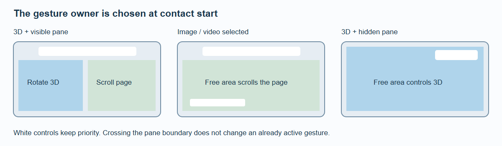

# Media and Interaction

Every detail page starts with one 3D entry. Add image, native video or YouTube entries with unique IDs:

```ts
media: [
  { id: 'model', kind: 'minimap', label: '3D view' },
  { id: 'front', kind: 'image', label: 'Front view', src: '/front.webp', alt: 'Front of the enclosure' },
  { id: 'assembly', kind: 'video', label: 'Assembly', src: '/assembly.webm', poster: '/assembly.webp',
    captions: [{ src: '/assembly-en.vtt', language: 'en', label: 'English', default: true }] },
  { id: 'demo', kind: 'youtube', label: 'Demonstration', videoId: 'M7lc1UVf-VE' }
]
```

An omitted 3D entry is inserted; duplicate minimap entries are ignored for presentation. Images need meaningful alt text. Use native WebVTT tracks for relevant audio. Replace the old source-less `drawing` entry with a real `image`; missing source data produces an unavailable message.

## A shared fit, separate media lifetimes

Images and videos preserve proportions in the model's same fit rectangle. Selecting them hides the main scene and releases its interaction/sensor participation. Loaded model resources and camera state are retained, so returning to 3D does not require a new download.

Native video uses ordinary controls, inline playback and metadata preload. It does not autoplay. Deselection pauses the video and releases its source. YouTube uses an explicitly selected privacy-enhanced iframe without autoplay; leaving removes that iframe. Host code cannot control arbitrary cross-origin pointer/wheel events inside the player.

Navigation away and back resets media selection to 3D. Media IDs are not a substitute for model asset identity or route history. The rail reveals the selected item by adjusting its own local scroll position, without scrolling the document.

## Gesture ownership



*White UI controls retain their own input. A gesture keeps its initial owner until release.*

| State | Free-area gesture |
| --- | --- |
| Flow detail, 3D | Model contact rotates; outside scrolls |
| Split detail, 3D | Left of pane controls 3D; pane scrolls |
| Split zoom, hidden pane | Entire free viewport controls 3D |
| Image/video | Free areas scroll the document |
| Native or embedded player UI | Player owns its controls |

Ownership is selected at gesture start and does not flip when the finger crosses a region boundary. Menu, rail, pane and real player controls always take priority over model interaction.

## Device orientation

SpatialCardGridSection and SpatialCarouselSection enable device orientation automatically; they have no `deviceOrientation` prop. Set `deviceOrientation` on BrandStageShell to enable detail geometry and minimaps as well. Access starts automatically where allowed. If explicit permission is needed, the framework requests it during a trusted internal navigation gesture without delaying navigation. Denial, missing sensors and reduced motion leave ordinary interaction available.

Device rotation is calibrated, smoothed and bounded. Orientation changes reset the reference. Scrolling pauses application, and release establishes a new reference before the effect fades back in.

The carousel uses a subtle shared view change with stronger rotation of the active item; mouse proximity still rotates individual items. Sensor behavior on real Android, Surface and iOS hardware requires direct checks. Desktop automation does not prove sensor axes, permission prompts or mobile browser-toolbar performance.

The executable `/demo/layout-media` fixture covers selected-media layout, player teardown, failure states and hidden-scene rendering. Its YouTube test uses a controlled iframe fixture; it does not claim validation of the remote service.
