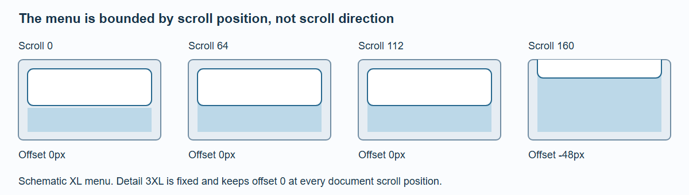

# Navigation and Glass

Put persistent navigation inside the `BrandStageShell` snippets. The shell supplies boxes and surfaces; the host supplies real links, branding and actions.

```svelte
<BrandStageShell {theme} items={[{ id: 'collection', label: 'Collection', href: '/collection' }]}>
  {#snippet brand()}<a href="/">My collection</a>{/snippet}
  {#snippet right()}<SettingsTrigger />{/snippet}
  {@render children()}
</BrandStageShell>
```

`left` and `right` are optional 80 × 40px satellite slots visible from XL. Menu height is 66px through L; from XL it is 64px with 16px top space. Omitted snippets create no empty interactive panel. Page Sections exposes satellite actions through Settings below XL. Navigation items use a native disclosure below L; custom `menu` snippets own their internal mobile behavior. The demo's appearance control uses a trigger and a native popover rather than trying to fit three choices inside one satellite.

## The 112px rule



*The same position rule drives native sticky layout and enhanced compensation.*

The ordinary shell stays at its starting position for the first 112px of document scroll. Beyond that it moves upward by `scrollY − 112`. It is not a direction-sensitive hide/reveal header. At scroll positions 0, 64, 112 and 160, its offsets are 0, 0, 0 and −48px.

Detail 3XL is the exception: its menu remains fixed. The native sticky layout and enhanced virtual-scroll compensation follow the same equation. Compensation is applied once; the renderer does not subtract the document scroll again from a fixed-region panel.

The shell is not keyed to the current route and keeps its owner through navigation. When both pages are at the top, it stays visible throughout the transition. A declared compact dock destination outside split 3XL instead fades the old top menu as the dock header takes over. Split 3XL retains the fixed menu. Focusing or zooming into the 3D model also moves and fades the native menu with its corresponding spatial surface; the native layout measurement stays unchanged.

## Breadcrumbs

Breadcrumb typography follows the viewport layout, not the inner grid. Breadcrumbs remain one line with native horizontal scrolling when necessary; the trailing end is visible without JavaScript and semantic reading order remains intact. In a split detail header, only the final current-page label is omitted, since the title row already identifies it. The preceding separator remains.

## Choosing the surface

| Content behind the surface | Presentation |
| --- | --- |
| Mixed native DOM and canvas, including ordinary menu/content | Native Page Sections surface |
| Integrated 3XL summary and content pane | Native DOM surface |
| Eligible fixed controls over the spatial scene | Authored GPU material where supported |
| No JavaScript or unavailable WebGPU | Native accessible fallback |

GPU glass cannot refract arbitrary native HTML as though it were a scene texture. Using an honest DOM surface over document content keeps text readable and avoids a fake snapshot that can drift from live content. Semantic navigation remains native even when the renderer owns an eligible decorative surface.

Do not add host-level padding, widths or sticky offsets around this shell. Doing so duplicates the shared layout contract and can separate DOM from projected panels during scroll or transitions.
