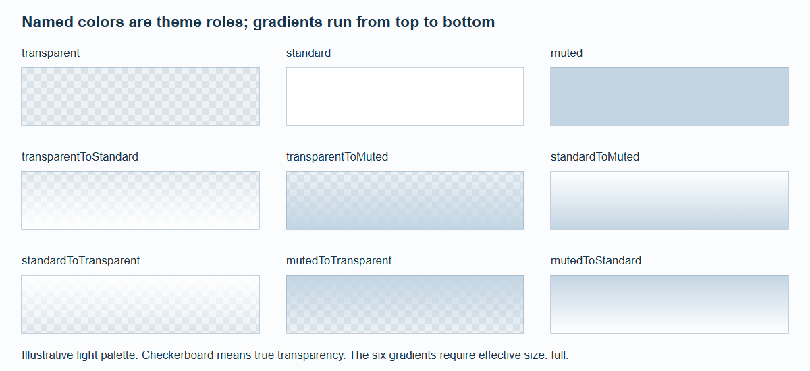
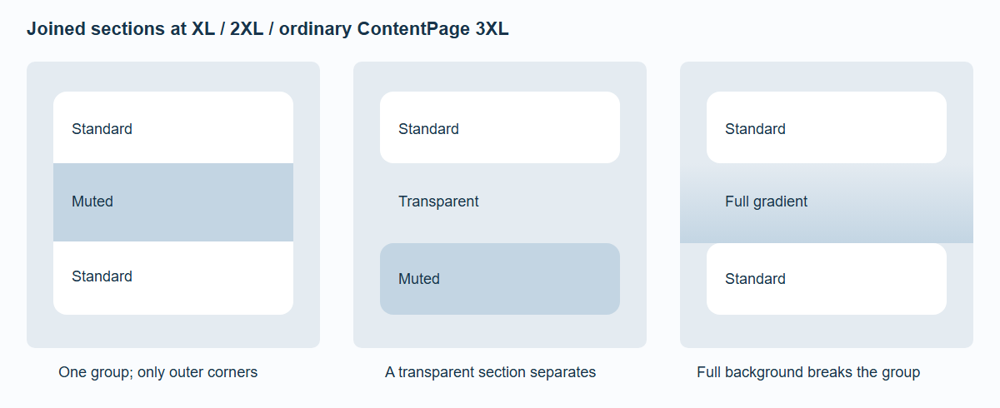

# Sections and Backgrounds

A Section owns its anchor, optional visible headline, grid padding and background. A navigation label and a displayed heading are different authoring choices.

```svelte
<Section section={{ id: 'details', title: 'Details', headline: 'Made for everyday use',
  background: { color: 'standard', size: 'standard' } }}>
  <p>Section content.</p>
</Section>
```

`id` stays stable for links and history. `title` labels generated navigation and accessibility. `headline` creates the visible heading. Omit `headline` to omit both the heading and its gap; padding remains. A section without a visible heading still has an accessible name.

## Background roles



*An illustrative light palette. Only effective full-width backgrounds support the six gradients; the theme supplies the actual standard and muted colors.*

| `color` | Result |
| --- | --- |
| `transparent` | Actual transparency |
| `standard` | Theme's standard section color |
| `muted` | Theme's muted section color |
| `transparentToStandard`, `transparentToMuted` | Top transparent, bottom named color |
| `standardToTransparent`, `mutedToTransparent` | Top named color, bottom transparent |
| `standardToMuted`, `mutedToStandard` | Vertical color-to-color gradient |

The default is transparent, standard width. `size: 'full'` extends only the background across the page; content stays on its capped grid. It does not introduce horizontal scrolling or stretch interactive content.

Detail sections always constrain backgrounds to standard width, including inside the 3XL pane. A gradient is valid only when its **effective** background is full-width. An invalid gradient becomes its end color and produces a deduplicated development diagnostic. For example, `transparentToMuted/full` on a detail page becomes solid muted. This deterministic fallback is an engineering choice, not a hidden change to the theme palette.



*Changing opaque color does not split a group. Transparency and full-width backgrounds do.*

## Corners and spacing

At XL, 2XL and ordinary ContentPage 3XL, contiguous opaque standard-width sections share outer panel corners. Only the first top corners and last bottom corners are rounded. Each section contributes its own grid padding; there is no extra automatic outer gap.

The 3XL detail pane owns its outer corners, so its sections have no detached grouping corners. Transparent and effectively full-width sections also do not acquire these corners. Grouping follows registered section order, not arbitrary helper elements in the DOM.

## Theme roles and compatibility

```ts
createSpatialTheme({
  id: 'collection', name: 'Collection',
  background: '#e7ebef',
  sectionBackgrounds: { standard: '#ffffff', muted: '#f3f5f7' },
  radii: { control: 12, panel: 16 }
});
```

Use a matching dark palette when supplying dark text/background roles. Section colors do not change the glass material's tint. `ContentPage background="..."` overrides that page's flat background for native and enhanced rendering while preserving lighting.

Legacy `section.style` is retained as an explicit compatibility path. Do not silently replace a custom tint or blur with the closest named role. An explicit `background` takes precedence over legacy tint, opacity and blur; legacy width and text color still apply. There is no diagnostic for combining those paths. The development diagnostic described above is specifically for unsupported gradients. See [Migration and Reference](Migration-and-Reference.md).
