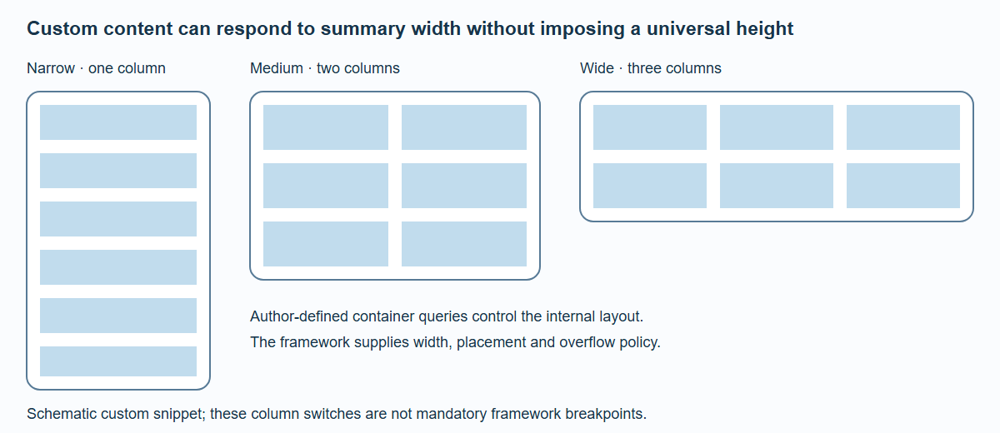

# Summary Panels

A summary is a real, stateful component. It can contain links, inputs, buttons and ordinary semantic content. Moving its presentation must not replace its live DOM with a screenshot or a second component instance.

`BrandStageShell` owns the persistent summary renderer. Route pages provide placement slots and data. The default summary uses the element title, optional eyebrow, features and action. Define a custom synchronous snippet in the persistent brand layout when the default does not fit your content:

```svelte
<BrandStageShell {theme}>
  {#snippet summary(context)}<CustomSummary {...context} />{/snippet}
  {@render children()}
</BrandStageShell>
```

The snippet receives `mode` (`detail` or `carousel`), `heading`, `contentInset`, element data and endpoint-address support. Keep initial output synchronous and content-only. Layout, frame and surface belong to the framework. Do not add a competing fixed-position outer panel.

For example, `CustomSummary.svelte` can register its real title as a shared endpoint:

```svelte
<script lang="ts">
  import { createCatalogEndpointAction, type SpatialSummaryContext } from '@spatial-elements/sveltekit';
  let { spatialElement, heading, address }: SpatialSummaryContext = $props();
  const catalogEndpoint = createCatalogEndpointAction();
</script>

<div class="custom-summary">
  <svelte:element this={heading} use:catalogEndpoint={address('title')}
    id={heading === 'h1' ? 'spatial-element-title' : undefined}
    tabindex={heading === 'h1' ? -1 : undefined}>
    {spatialElement.title}
  </svelte:element>
  <p>Custom content for {spatialElement.title}.</p>
</div>
```

Create the action inside this child component, which is instantiated under the persistent summary host. Creating it in the outer layout before `BrandStageShell` cannot read the child's endpoint context. Register only roles that actually exist in the custom content; missing roles use the normal fallback instead of pretending a different DOM element is the matching title or action.

The framework already applies `contentInset`; do not add it a second time to the snippet. The detail heading keeps `id="spatial-element-title"` so the surrounding panel's accessible label resolves correctly.

## Natural height and responsive content



*A custom snippet chooses its own container-query columns. The framework does not prescribe these internal breakpoints or equalize panel heights.*

The framework knows the summary's width and anchor. Text determines a detail summary's natural height. Wide flow detail summaries cap local overflow to the hero area; mobile and 3XL detail summaries contribute their real height to document flow. Custom content can use container queries to choose one, two or three internal columns based on the actual summary width.

Compact carousel summaries are different: below 840px they show framework-owned title/eyebrow strips of 40px or 66px and hide the full custom-summary content. Do not put an essential action exclusively in that hidden compact presentation.

Height can change when a font or late content arrives. Those changes trigger layout invalidation; they are not a reason to measure every frame. Keep media dimensions reserved when possible. Arbitrary external font changes during an animation are still a real layout change and must be tested rather than assumed invisible.

## Ownership and transition boundaries

The persistent host gives a summary a lifetime beyond a route's placement node. Placement and ownership are different responsibilities: manually reparenting a route-owned Svelte subtree does not prevent the route from destroying it.

The isolated `/proof/persistent-summary` fixture demonstrates DOM identity, input value, focus, effects and exactly one cleanup across ownership changes. Production detail composition uses the same persistent-root approach. Staged-navigation handoff builds on that lifecycle contract; it needs its own cancellation and loading tests in addition to the layout proof.

This separation keeps the user's ongoing interaction intact and avoids rendering two copies of the same form during a visual handoff.
