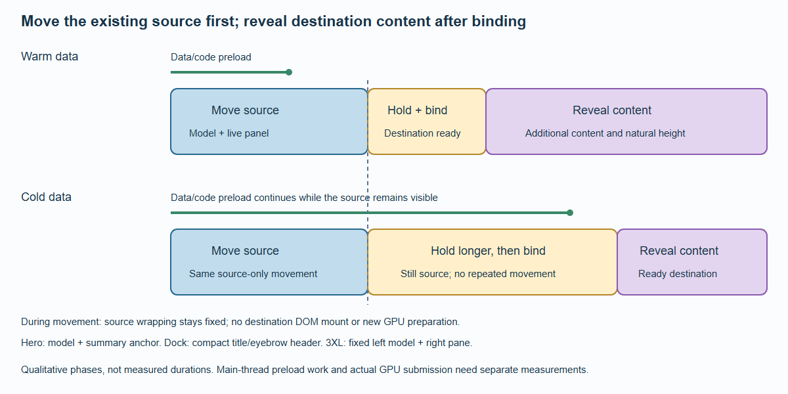

# Transitions

A known destination should not require a complete destination page just to begin moving.
The same layout resolver that positions the detail page supplies its model fit and panel
anchor before that page exists. Natural text height remains a separate content concern.

## Movement, holding and content



*The phase widths are illustrative. Loading can extend the hold; it does not require a second source movement or an empty intermediate page.*

Forward navigation from a prepared card or the selected carousel element has three stages:

1. **Move the source.** The existing model and live panel move toward the resolved endpoint.
   Their source content width and line wrapping stay fixed. Other collection content fades.
   The destination route has not mounted, and this phase does not prepare GPU resources.
2. **Hold and bind.** Keep that presentation visible at its endpoint while the router mounts
   the detail page, restores its scroll position and binds its prepared model. A slow request
   extends this still interval; it does not remove the source or restart the movement.
3. **Reveal content.** Additional detail content, natural summary height and the background
   appear. A retained carousel summary transfers its actual component and DOM into the
   destination slot, preserving local form state. No screenshot clone substitutes for it.

The router can preload code and data during movement. Downloading is asynchronous, but module
execution and application `load` work can still occupy the main thread. Keep those functions
small, preload likely destinations and measure cold routes separately from warm ones. A resolved
Promise alone does not prove that work ran outside animation frames.

## Hero and compact destinations

An ordinary detail URL, or `#overview`, opens the overview. At smaller widths the panel and
model follow the flow composition; in the 3XL split layout the left stage remains fixed and
the panel belongs to the right content pane.

An arbitrary fragment cannot predict a compact header: the section may still lie within the
overview, or a short document may clamp scrolling. Such navigation uses the ordinary transition
after the destination is available. When an application knows that a section opens a completely
docked view, it can declare that endpoint on a list item or carousel section link:

```ts
const readingItem = {
  ...item,
  href: `${item.href}#reading`,
  targetPresentation: 'dock' as const
};

const carouselItem = {
  ...item,
  summary: {
    ...item.summary,
    sectionLink: {
      href: `${item.href}#reading`,
      label: 'Read the details',
      targetPresentation: 'dock' as const
    }
  }
};
```

This declaration is a contract about the destination, not a request to insert artificial scroll
space. The actual bound composition is checked. If it disagrees, the hold is released and the
usable destination appears. In 3XL, a declared dock destination still keeps the model on the
large fixed left stage; the right pane header receives the moving panel text.

Only the existing surface, title and eyebrow move into a compact header. Text scales uniformly;
it does not stretch with a wide, short background. Other summary content fades, and the live
summary is adopted after the new header is visible. Custom summaries register their text roles
as shown in [Summary Panels](Summary-Panels.md).

## Interaction and fallback

The moving source is temporarily inert. Pointer and sensor effects stop competing with the
transition; sensor motion resumes from a recalibrated neutral pose. Resizing, scrolling, Escape,
another navigation or leaving the page cancels obsolete ownership. Cleanup restores source
styles and input, or releases the source after the route has legitimately replaced it.

Unprepared sources, unsupported routes, ambiguous occurrences and summaries whose internal
scroll/clipping cannot be transferred safely keep the ordinary navigation path. Back/Forward
and the return to a collection retain native URL, history, focus and scroll semantics. Links
with explicit SvelteKit focus, scroll, replacement or reload policies keep those policies.
Reduced motion skips the artificial animation interval. No JavaScript and unavailable WebGPU
continue to use ordinary links and poster-based layout.

## What timing measurements mean

First source movement, GPU submission and total content readiness are different measurements.
The production tests record all three phases, DOM ownership, resource creation and frame
intervals. Repeated warm and cold measurements must state the browser and machine; they cannot
guarantee identical timing on every phone or every application's data loader. The layout removes
destination measurement from the early path, while the production performance report records
what the implementation achieves on the tested environment.
