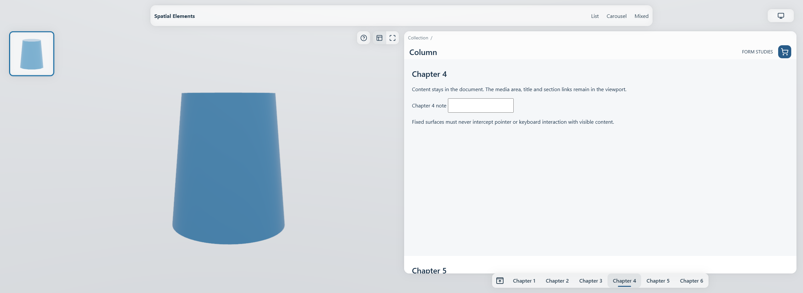
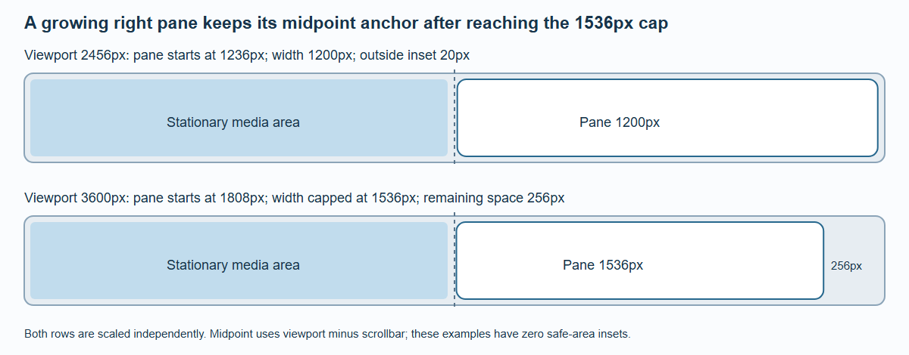

# Ultra-Wide Layout

At 2300px and wider, with at least 512px of usable height, detail pages split into a stationary media area and a document-scrolling content pane. ContentPages and carousels retain their ordinary centered composition.

*The production fixture after a real section-link click. The same document scrolls; the pane has no independent vertical scrollbar.*

## Geometry

Let `W` be viewport width minus the classic scrollbar, before subtracting safe areas. The pane begins at `W / 2 + 8px`. Its width grows from the remaining right-hand area, keeps a 20px outside inset plus the right safe inset, and stops at 1536px. At that cap its left edge stays anchored to the midpoint; extra space appears on the far right.

*The pane stops growing at 1536px. The additional right-hand space does not move its left anchor; safe areas and scrollbar widths are zero in this comparison.*

| Region | Vertical rule, before safe-area offsets |
| --- | --- |
| Pane top | 96px |
| Pane header | 86px |
| Reading body begins | 182px |
| Section submenu | 44px, 16px above the bottom edge |
| Reading body ends | Viewport height − 60px |
| Media area | Top 96px, bottom 16px |

The pane's width chooses its own content grid. It reaches a 1200px grid container at a 2456px viewport without a classic scrollbar or safe-area reductions. This is a container-grid change inside the same 3XL page composition.

## One scroll owner

The body is ordinary document flow with 182px reserved before it and 60px after it. A content point at document-body offset `d` appears at `182 + d − scrollY`. The media region, pane material, header and submenu are fixed and do not create document height.

Native fragment links, focus, Home/End, history and the final line therefore use the browser's document coordinates. A short document cannot invent extra scroll travel just to move an already visible anchor to the reading edge. There is no second vertical scroll container to trap wheel or keyboard input.

Without JavaScript, page-colored covers bound the native reading area. Enhanced rendering clips painting and hit testing to the real pane window. The integrated summary stays native DOM, while the menu and media controls can use their appropriate surfaces. Opaque native covers are not represented as GPU glass refracting arbitrary HTML.

## Resize and zoom retain state

Crossing 2XL/3XL preserves the reading section and its offset rather than blindly preserving the old numeric scrollY. The controller caches that anchor before CSS reflow and restores it after summary ownership and body height settle. A regression fixture holds Chapter 4 at 182px, then 142px in 2XL, then 182px on return.

Zoom continuously fades, blurs and moves the whole pane using the same damped focus curve as the properties panel in smaller layouts. Header, surface, body and submenu share one perspective pivot; the integrated summary does not receive a second animation. These are paint transforms, so document height, anchors and the reading position stay unchanged. Hidden controls become inert. Returning restores the same live inputs and scroll state. The left free region controls 3D while the visible right pane scrolls. With image/video selected, free areas scroll the document. With the pane hidden, the full free viewport controls the model; real controls still take priority.

Use `/demo/layout-pane` for anchors, reload, focus, late content and resize checks. Desktop WebGPU, native hydration and no-JavaScript cases are automated. Physical touch behavior and browser Find still need device-level review.
